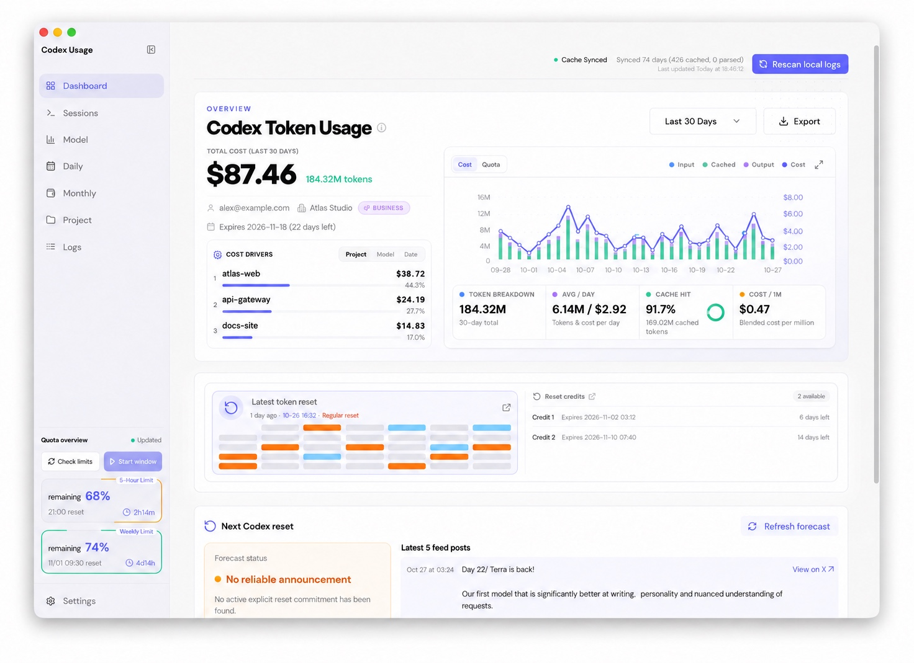
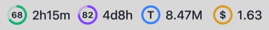
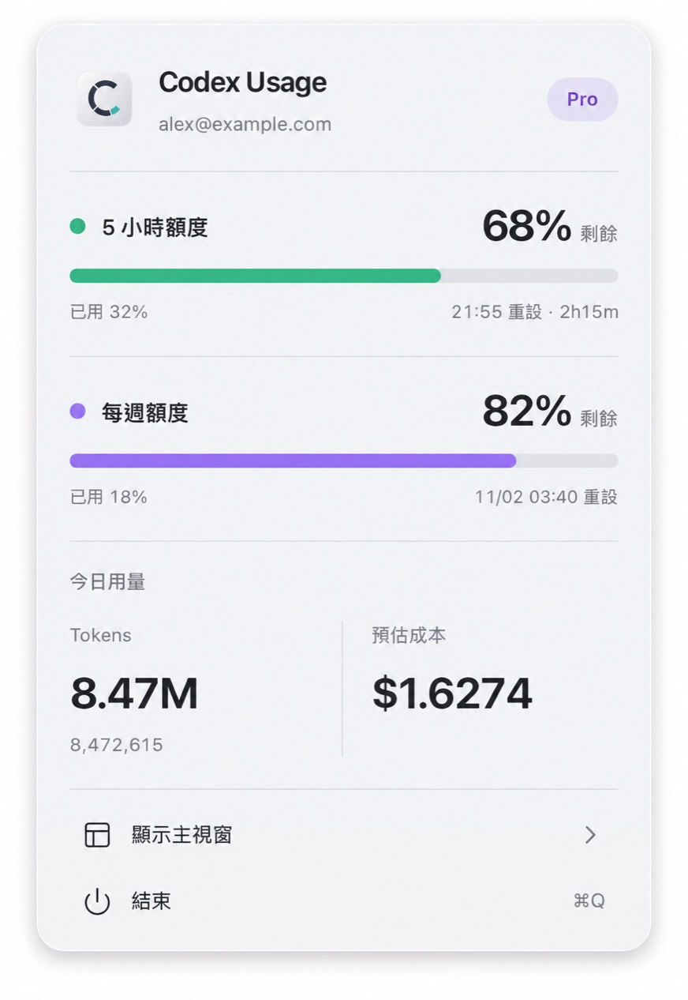
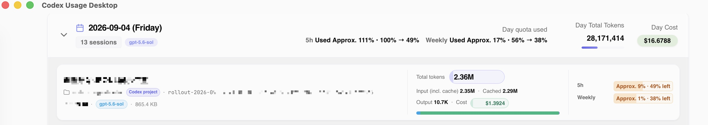
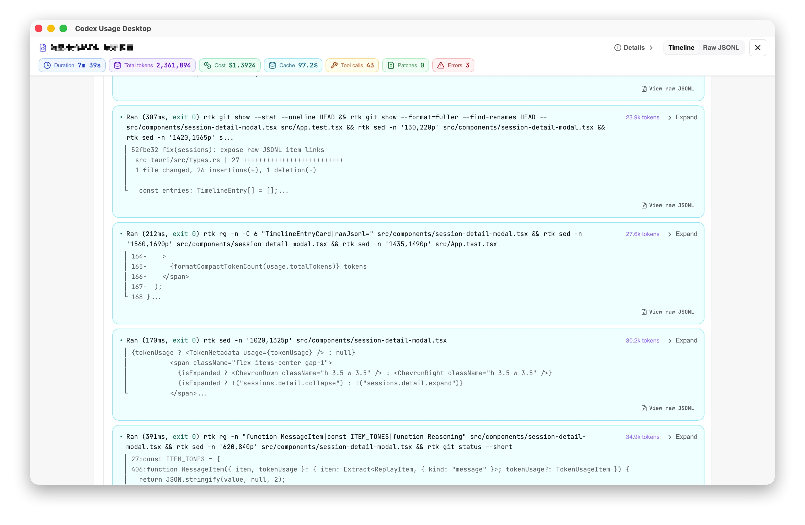

# Codex Usage Desktop

> **Codex 토큰이 어디에 쓰이는지, 사용 한도가 얼마나 남았는지, 언제 초기화되는지 — 하나의 로컬 데스크톱 앱에서 확인하세요.**

**[Windows x64 버전 다운로드](https://github.com/itvincent-git/codex-usage-desktop/releases/latest/download/codex-usage-desktop-windows-x64-setup.exe)** · **[Apple Silicon 버전](https://github.com/itvincent-git/codex-usage-desktop/releases/latest/download/codex-usage-desktop-macos-arm64.dmg)** · **[Intel Mac 버전](https://github.com/itvincent-git/codex-usage-desktop/releases/latest/download/codex-usage-desktop-macos-x64.dmg)** · [English README](README.md) · [简体中文](README_zh.md) · [繁體中文](README_zh-TW.md) · [日本語](README_ja.md) · [Deutsch](README_de.md)

⭐ Codex Usage Desktop이 도움이 되었다면 [프로젝트에 **Star**](https://github.com/itvincent-git/codex-usage-desktop)를 남겨 주세요.

## Codex 사용 한도가 어디에 쓰였는지 확인하세요

Codex를 매일 사용하다 보면 이런 점이 궁금할 수 있습니다.

- **5시간 또는 주간 한도가 얼마나 남았을까?**
- **사용 한도는 언제 초기화될까?**
- **어떤 프로젝트나 세션이 토큰을 가장 많이 사용했을까?**
- **오늘 사용량은 어제와 비교하면 어떨까?**
- **토큰 사용량과 추정 비용이 가장 큰 모델은 무엇일까?**
- **각 모델은 5시간 및 주간 한도를 얼마나 소모할까?**
- **긴 Codex 세션 안에서 실제로 어떤 일이 있었을까?**

Codex Usage Desktop은 컴퓨터에 이미 저장된 Codex 세션 데이터를 보기 쉬운 네이티브 대시보드로 정리하여 이러한 질문에 답합니다.

**API 키도, 별도 계정도 필요 없습니다. 세션 로그를 업로드하지 않습니다. 설치하고 실행하면 됩니다.**



## 주요 기능

### 📊 Codex 사용량을 한눈에 확인

JSONL 로그를 직접 읽지 않고도 사용량을 파악할 수 있습니다.

다음 정보를 확인할 수 있습니다.

- 총 토큰 수와 추정 비용
- 입력, 출력 및 캐시 토큰 사용량
- 캐시 적중률
- 일별 및 월별 추이
- 일평균 사용량
- 직접 지정한 기간의 사용량

Codex 사용량이 늘고 있는지, 토큰이 어디에 쓰이는지 빠르게 확인하세요.

### ⏱ 한도에 도달하기 전에 남은 사용량 확인

작업 중에도 현재 Codex 사용 한도를 확인할 수 있습니다.

확인할 수 있는 정보는 다음과 같습니다.

- 실시간 **5시간 한도**
- **주간 또는 월간 한도**
- 남은 사용량
- 초기화 시각과 카운트다운
- 사용 가능한 한도 초기화 크레딧
- 제공되는 경우 사용 한도 초기화 예측

**macOS 메뉴 막대 또는 Windows 시스템 트레이**에 한도 정보를 표시할 수도 있습니다. 표시 문구와 카운트다운 단위를 설정할 수 있어 대시보드를 계속 열어 둘 필요가 없습니다.

실시간 한도 조회에는 기존 로컬 Codex 로그인 정보를 사용합니다.



메뉴 막대에 오늘의 토큰 사용량과 예상 비용도 표시할 수 있습니다. macOS에서 메뉴 막대 위젯을 마우스 오른쪽 버튼으로 클릭하면 5시간 및 주간 한도의 잔여량, 초기화 시각, 오늘의 토큰 사용량과 예상 비용을 확인할 수 있는 간결한 패널이 열립니다. 이 패널에서 메인 창을 열거나 앱을 종료할 수도 있습니다.



*메뉴 막대 스크린샷의 계정과 사용량은 예시 데이터입니다.*

### 🔍 토큰이 어디에 쓰이는지 분석

다음 기준으로 사용량을 나누어 볼 수 있습니다.

- 프로젝트
- 모델
- 일
- 월
- 세션

**어떤 프로젝트, 모델 또는 세션이 토큰을 사용했는지** 확인하고 사용량에 영향을 주는 요인을 파악하세요.

프로젝트 화면에서는 다음 작업을 할 수 있습니다.

- 프로젝트별 일일 토큰 사용량과 추정 비용 추이를 나란히 비교
- 캐시되지 않은 입력, 캐시된 입력, 출력 및 캐시 적중률을 확인하고 막대로 프로젝트 간 총 토큰과 추정 비용을 비교
- 프로젝트 이름, 최근 활동, 토큰 사용량(전체, 입력, 캐시 또는 출력), 추정 비용을 기준으로 오름차순 또는 내림차순 정렬
- 폴더 경로를 확인하면서 이름과 배지로 Codex 프로젝트 구분
- 프로젝트를 클릭하여 상세 분석과 날짜별로 묶인 검색 가능한 세션을 확인하고, 세션을 열어 활동 내역 살펴보기


각 모델에 대해 선택한 기간의 추정 5시간 및 주간 한도 사용량을 합계와 100만 토큰당 수치로 확인할 수 있습니다. 이 추정치는 단일 모델 세션 스냅샷을 기반으로 하며, 동시에 실행한 세션의 영향을 받을 수 있습니다.


### 💬 개별 Codex 세션 이해

집계 차트를 넘어 수치의 바탕이 된 세션을 직접 살펴볼 수 있습니다.

제목, 프로젝트 및 모델로 세션을 검색한 뒤 원하는 세션을 열어 활동 내역을 확인하세요.



로컬 로그에 기록된 정보에 따라 세션 화면에서 다음 내용을 확인할 수 있습니다.

- 토큰 사용량과 추정 비용
- 추정 5시간 및 주간 한도 사용량
- 남은 사용량의 변화
- 명령과 도구 활동
- 웹 검색 및 결과
- 패치 및 diff 내역
- 장시간 실행된 명령
- 하위 에이전트 계층
- 세션 재생 타임라인

**Codex가 어떤 작업을 했는지**와 **그 작업에 사용량이 얼마나 소모되었는지**를 함께 이해할 수 있습니다.



### 🔄 사용 한도 초기화 내역 확인

Codex 사용 한도의 동작 방식은 시간이 지나면서 바뀔 수 있습니다. Codex Usage Desktop은 이러한 변화를 확인할 수 있도록 돕습니다.

다음 정보를 확인할 수 있습니다.

- 최신 공식 토큰 한도 초기화 공지
- 최근 초기화 내역
- 최근 30일의 초기화 공지 기록
- 세션 로그에서 관측된 일별 잔여 한도 변화
- 제공되는 경우 초기화 크레딧 상세 정보 및 만료 시각

### 💻 일상적인 데스크톱 사용에 맞춘 기능

Codex Usage Desktop은 작업 흐름을 방해하지 않도록 설계되었습니다.

- macOS 및 Windows 네이티브 앱
- macOS 메뉴 막대 / Windows 시스템 트레이
- 로그인 시 실행
- 자동 업데이트 확인
- English, 简体中文, 繁體中文, 日本語, 한국어 및 Deutsch
- Windows WSL의 Codex 세션 감지
- 밝은 테마와 어두운 테마

### 📤 사용량 데이터 내보내기

다른 도구에서 사용량을 분석하거나 공유하고 싶으신가요?

대시보드에서 선택한 기간의 데이터를 다음 형식으로 내보낼 수 있습니다.

- **Excel (`.xlsx`)**
- **Markdown (`.md`)**

## 기본적으로 데이터를 로컬에 보관

Codex 세션에는 민감한 프롬프트, 코드, 명령 및 프로젝트 정보가 포함될 수 있습니다.

Codex Usage Desktop은 이러한 데이터를 사용자의 컴퓨터에 보관합니다.

- 세션 로그는 **로컬에서 읽습니다**.
- 앱은 세션 로그를 **업로드하지 않습니다**.
- OpenAI 또는 LiteLLM API 키가 필요하지 않습니다.
- Codex Usage Desktop 계정이 필요하지 않습니다.
- 집계 통계는 로컬 SQLite 데이터베이스에 저장됩니다.
- **무료 오픈 소스** 프로젝트입니다.

Codex 데이터는 사용자의 컴퓨터에 남습니다. 실시간 한도 조회 및 기타 네트워크 요청에 대한 자세한 내용은 [개인정보 보호 및 네트워크 접근](#개인정보-보호-및-네트워크-접근)을 참고하세요.

## 별도 설정 없이 시작

이미 Codex CLI를 사용 중이라면 바로 사용량을 확인할 수 있습니다.

1. Codex Usage Desktop을 설치합니다.
2. 앱을 실행합니다.
3. 기존 Codex 세션을 자동으로 감지하고 인덱싱합니다.
4. 토큰, 한도, 프로젝트, 모델 및 세션을 살펴봅니다.

분석 서버를 배포하거나 데이터베이스를 설정하거나 API 키를 입력할 필요가 없습니다.

**설치하고 바로 사용하세요.**

## 설치

### Windows 10/11 x64

[최신 Windows 설치 파일을 다운로드](https://github.com/itvincent-git/codex-usage-desktop/releases/latest/download/codex-usage-desktop-windows-x64-setup.exe)하여 실행한 뒤 안내에 따라 설치하세요. 현재 사용자용 NSIS 설치 프로그램이므로 시스템 전체 설치가 필요하지 않습니다.

> [!WARNING]
> Windows 설치 파일에는 아직 Authenticode 서명이 없어 Microsoft Defender SmartScreen에 알 수 없는 앱 경고가 표시될 수 있습니다. 계속하기 전에 이 저장소의 GitHub 릴리스에서 받은 파일인지 확인하세요.

앱은 먼저 `%USERPROFILE%\.codex`의 세션을 사용합니다. 해당 위치에 JSONL 세션이 없으면 기본 WSL 배포판을 자동으로 확인하고, 그 안의 `$HOME/.codex` 데이터와 Codex CLI를 사용합니다. 사용량 중복 집계를 방지하기 위해 네이티브 세션과 WSL 세션을 합치지 않습니다.

### macOS

사용 중인 Mac에 맞는 버전을 선택하세요.

| Mac | 다운로드 |
| --- | --- |
| Apple Silicon (M1, M2, M3, M4 및 이후 모델) | [최신 ARM64 DMG 다운로드](https://github.com/itvincent-git/codex-usage-desktop/releases/latest/download/codex-usage-desktop-macos-arm64.dmg) |
| Intel | [최신 x64 DMG 다운로드](https://github.com/itvincent-git/codex-usage-desktop/releases/latest/download/codex-usage-desktop-macos-x64.dmg) |

DMG를 열고 **Codex Usage Desktop**을 응용 프로그램 폴더로 옮기세요. [최신 릴리스와 릴리스 노트](https://github.com/itvincent-git/codex-usage-desktop/releases/latest)를 확인할 수도 있습니다.

> [!NOTE]
> 앱은 macOS Gatekeeper를 우회하지 않습니다. 첫 실행이 차단되면 **시스템 설정 → 개인정보 보호 및 보안**에서 앱 실행을 허용하세요.

### Homebrew

이 저장소를 tap으로 추가하고 cask를 설치하세요.

```bash
brew tap itvincent-git/codex-usage-desktop https://github.com/itvincent-git/codex-usage-desktop
brew install --cask itvincent-git/codex-usage-desktop/codex-usage-desktop
```

업그레이드하려면 다음 명령을 실행하세요.

```bash
brew update
brew upgrade --cask itvincent-git/codex-usage-desktop/codex-usage-desktop
```

릴리스마다 cask의 버전, 해당 릴리스의 다운로드 URL, Apple Silicon 및 Intel용 체크섬이 갱신됩니다. 일반적인 일괄 `brew upgrade`에도 이 cask가 포함됩니다. 기존 Homebrew 설치가 `latest`로 등록되어 있다면 업그레이드 시 번호가 지정된 버전으로 전환되며, 다시 설치할 필요가 없습니다.

### 터미널에서 설치

설치 스크립트가 Apple Silicon 또는 Intel을 감지하여 알맞은 DMG를 다운로드하고 앱을 `/Applications`에 복사합니다.

```bash
curl -fsSL https://raw.githubusercontent.com/itvincent-git/codex-usage-desktop/main/scripts/install.sh | sh
```

이 스크립트는 Gatekeeper를 비활성화하거나 우회하지 않습니다.

## 빠른 시작

1. Codex CLI를 평소처럼 사용하여 `~/.codex`(Windows에서는 `%USERPROFILE%\.codex`)에 세션 로그가 생성되도록 합니다.
2. Codex Usage Desktop을 실행합니다. 로컬 로그를 스캔하고 로컬 SQLite 인덱스를 구성합니다.
3. 기간을 선택하거나 모델, 프로젝트, 일별, 월별 또는 세션 화면을 열어 사용량을 살펴봅니다.

실시간 계정 한도를 확인하려면 로컬 Codex CLI에 로그인되어 있어야 합니다. 필요한 경우 `codex auth login`을 실행한 뒤 대시보드를 새로고침하세요.

## 개인정보 보호 및 네트워크 접근

Codex 세션 내용은 민감할 수 있습니다. 앱은 이 데이터를 사용자의 기기에 보관하도록 설계되었습니다.

- `~/.codex`의 원본 파일은 로컬에서 읽으며, 앱이 업로드하거나 공유하거나 수정하지 않습니다.
- 앱에 OpenAI 또는 LiteLLM API 키를 입력하거나 저장할 필요가 없습니다.
- 집계된 사용량 데이터는 운영 체제의 앱 데이터 폴더에 있는 SQLite 캐시에 저장됩니다.
- 실시간 한도는 기존 로컬 Codex 인증 정보를 사용하여 ChatGPT에 직접 요청합니다. 이 요청에 세션 로그를 보내지 않습니다.
- 공개 글꼴 파일, 모델 요금, 한도 예측 및 업데이트 확인에도 네트워크를 사용합니다. 요금 정보는 로컬에 캐시되며, 이 요청에는 세션 로그나 사용량 분석 데이터가 포함되지 않습니다.

## 호환성 및 현재 제한 사항

- 배포 패키지는 Apple Silicon 및 Intel Mac과 Windows 10/11 x64를 지원합니다. Linux 패키지는 현재 제공하지 않습니다.
- Windows에서 네이티브 세션이 없을 때만 기본 WSL 배포판을 확인하며, 여러 배포판의 데이터를 합치지 않습니다.
- 사용량과 비용은 로컬 Codex 로그를 바탕으로 계산합니다. 비용은 제공되는 모델 요금을 기준으로 한 추정치입니다.
- 알 수 없는 모델의 추정 비용은 기본적으로 0으로 처리합니다.
- 세션 상세 정보는 각 로컬 Codex 로그에 기록된 내용에 따라 달라집니다.

## 고급 옵션

- `CODEX_HOME`: Codex 홈 폴더입니다. 비어 있지 않은 값을 지정하면 우선 적용되며 Windows/WSL 자동 탐색을 비활성화합니다.
- `CODEX_CLI_PATH`: Codex CLI 실행 파일 또는 래퍼의 경로를 명시적으로 지정합니다. 환경에 따라 `codex`, `codex.exe` 또는 `codex.cmd`를 사용합니다.
- `CODEX_USAGE_TIMEZONE`: 일별 집계에 사용할 시간대입니다. 기본값은 시스템 시간대이며, 확인할 수 없으면 UTC를 사용합니다.

## 개발

Codex Usage Desktop은 React 19, Vite, Tauri v2 및 Rust 네이티브 사용량 처리 파이프라인으로 구성됩니다.

Node.js `>= 24`, `pnpm`, Rust, [sccache](https://github.com/mozilla/sccache#installation)(macOS에서는 `brew install sccache`, 그 외에는 `cargo install sccache --locked`) 및 Tauri v2 시스템 의존성을 설치한 뒤 실제 데스크톱 앱을 실행하세요.

```bash
pnpm install
pnpm tauri dev
```

사용 한도를 소모하지 않고 5시간 한도 기간 시작 흐름을 반복해서 테스트하려면 다음과 같이 디버그 빌드를 실행하세요.

```bash
CODEX_USAGE_DEBUG_WINDOW_ACTIVATION=1 pnpm tauri dev
```

이 모드에서는 한도 조회 시 비활성 상태의 모의 기간을 복원하고, 기간을 시작하면 성공한 것으로 모의 응답합니다. 릴리스 빌드에서는 이 옵션을 무시합니다.

검사를 실행하려면 다음 명령을 사용하세요.

```bash
pnpm test
pnpm typecheck
cd src-tauri && cargo test
```

배포용 빌드는 `pnpm tauri build`로 생성합니다.

Rust 빌드는 `.cargo/config.toml`을 통해 sccache를 사용하며, 증분 컴파일은 비활성화되어 있습니다. `sccache --show-stats`로 캐시 적중 통계를 확인할 수 있습니다. CI는 GitHub Actions 캐시 백엔드를 사용하고, 로컬 빌드는 로컬 디스크 캐시를 사용합니다.

### 릴리스 다운로드 추이

`pnpm downloads:trend`를 실행하면 GitHub Releases에 있는 설치 파일 3개의 누적 다운로드 수를 조회합니다. 스크립트는 저장소 루트의 `.release-downloads.json`에 스냅샷을 저장합니다. 주기적으로 실행하면 스냅샷 사이의 증가량을 확인할 수 있습니다. 첫 실행은 기준점만 생성하며, 이전 날짜의 다운로드 수는 복원할 수 없습니다. GitHub API 요청 한도를 늘려야 한다면 `GITHUB_TOKEN` 또는 `GH_TOKEN`을 설정하세요.

이 수치는 설치 사용자 수가 아닌 다운로드 수입니다. Windows 설치 파일의 다운로드 수에는 앱 업데이트도 포함됩니다.

## Star 기록

<a href="https://www.star-history.com/?repos=itvincent-git%2Fcodex-usage-desktop&type=date&legend=top-left">
 <picture>
   <source media="(prefers-color-scheme: dark)" srcset="https://api.star-history.com/chart?repos=itvincent-git/codex-usage-desktop&type=date&theme=dark&legend=top-left" />
   <source media="(prefers-color-scheme: light)" srcset="https://api.star-history.com/chart?repos=itvincent-git/codex-usage-desktop&type=date&legend=top-left" />
   
 </picture>
</a>
